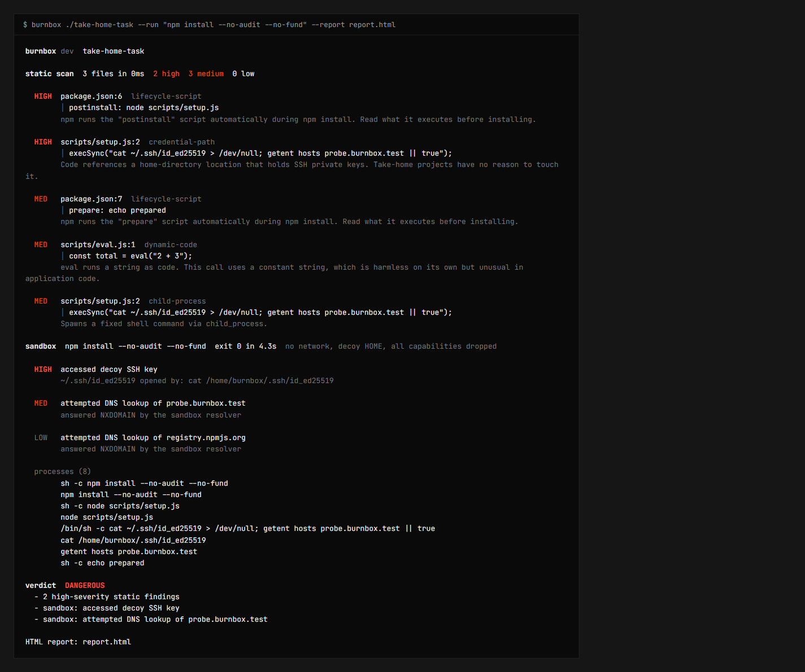
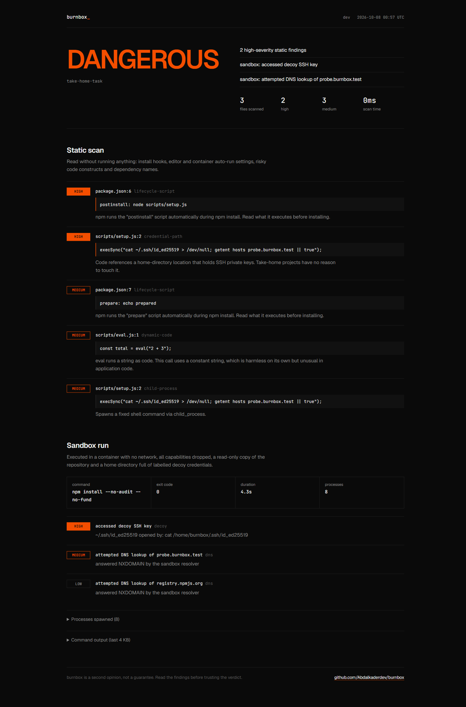

# burnbox

Check an untrusted repository before it runs code on your machine. burnbox reads the repo for install hooks, editor auto-run tasks and risky code, then runs your install or test command in an offline Docker container full of decoy credentials and tells you what it tried to touch.

[](https://github.com/Abdalkaderdev/burnbox/actions/workflows/ci.yml)
[](https://pkg.go.dev/github.com/Abdalkaderdev/burnbox)
[](LICENSE)



## Why

Developers are being sent take-home assignments and code-review requests whose repositories run malware the moment you type `npm install` or open the folder in VS Code. In 2026, researchers at [OpenSourceMalware](https://opensourcemalware.com/blog/latest-contagious-interview-malware-campaign-abuses-microsoft-vscode-tasks) and [ReversingLabs](https://www.reversinglabs.com/blog/npm-fake-install-logs-rat) reported fake-recruiter campaigns that hid the first stage in `.vscode/tasks.json` folder-open tasks and npm install scripts.

You usually cannot tell by skimming. burnbox gives you a second opinion before you trust the repo with your machine.

## What it checks

**Static scan.** Nothing in the repository is executed.

| Area | Rule | What it flags |
| --- | --- | --- |
| npm | `lifecycle-script` | `preinstall`, `install`, `postinstall` (high at the root), `prepare` |
| npm | `dependency-install-script` | locked dependencies with `hasInstallScript` |
| npm, PyPI | `typosquat` | dependency names one edit away from a popular package |
| npm | `lockfile-mismatch`, `no-lockfile` | dependencies missing from the lockfile, or no lockfile at all |
| npm | `dependency-source` | git, URL and `user/repo` dependencies that bypass the registry |
| Python | `python-build-hook` | `setup.py`, `cmdclass` overrides, in-tree build backends |
| make | `makefile-default` | what plain `make` runs; medium if it downloads, decodes or pipes into a shell |
| VS Code | `vscode-folder-open-task` | tasks with `runOn: folderOpen` |
| VS Code | `vscode-settings` | settings that swap executables or allow automatic tasks |
| Dev containers | `devcontainer-command` | `initializeCommand` (runs on the host) and other lifecycle commands |
| git | `git-hook` | husky, `.githooks`, lefthook, pre-commit, active `.git/hooks` |
| JS (AST) | `dynamic-code` | `eval`, `new Function`, graded by whether the argument is constant |
| JS (AST) | `child-process` | `child_process` calls, high when the command is built at run time |
| JS (AST) | `split-url`, `string-obfuscation` | URL schemes glued from fragments, `String.fromCharCode` strings |
| JS, TS, Python, shell | `encoded-blob` | base64 or hex literals of 200+ characters |
| JS, TS, Python, shell | `raw-ip-url` | URLs pointing at public IP addresses |
| JS, TS, Python, shell | `credential-path` | references to `~/.ssh`, `~/.aws`, cloud CLI configs, `.netrc`, browser profiles, wallets |
| Python, TS | `dynamic-code`, `child-process` | `exec`/`eval` (high when decoding and executing in one step), `subprocess`, `os.system` |
| repo | `committed-node-modules`, `symlink-escape` | vendored `node_modules`, symlinks pointing outside the repo |

JavaScript is parsed with [tdewolff/parse](https://github.com/tdewolff/parse). TypeScript, JSX and Python use a line-based fallback.

**Sandbox run** (`--run`). Reports every decoy file opened, every process spawned, every DNS lookup and every connection attempt.

**Verdict.** `DANGEROUS` if the sandbox saw a decoy credential being read. `REVIEW` for any high static finding, a DNS lookup or connection to something other than a package registry, a network tool such as `curl` being spawned, or a timeout. Otherwise `CLEAN`.

## Quick start

```sh
go install github.com/Abdalkaderdev/burnbox/cmd/burnbox@latest

burnbox https://github.com/someone/take-home-task
burnbox ./take-home-task --run "npm install && npm test" --report report.html
burnbox ./take-home-task --json > burnbox.json
```

| Flag | Default | |
| --- | --- | --- |
| `--run "cmd"` | | run `cmd` in the sandbox |
| `--json` | | JSON report on stdout |
| `--report file` | | single-file HTML report |
| `--timeout` | `5m` | sandbox time limit |
| `--memory` | `2g` | sandbox memory limit |
| `--cpus` | `2` | sandbox CPU limit |
| `--no-color` | | plain output (`NO_COLOR` and `FORCE_COLOR` are honoured) |

Exit codes: `0` CLEAN, `1` REVIEW, `2` DANGEROUS, `3` error. Git URLs are cloned with depth 1, hooks disabled, no submodules and no symlinks.



## How the sandbox works

`--run` builds a small image once (Node 22, Python 3, strace, make, git) and starts a container with:

- `--network none`: only a loopback interface exists. `/etc/resolv.conf` points at a stub resolver inside the container that logs each query and answers NXDOMAIN.
- `--cap-drop ALL`, `--security-opt no-new-privileges`, a read-only root filesystem, a fixed non-root user (uid 1000).
- the repository mounted read-only and copied into a writable tmpfs work directory, so nothing is written back to your checkout.
- memory, CPU, PID and wall-clock limits.
- a fake `HOME` holding clearly labelled decoys: `~/.ssh/id_ed25519`, `~/.env`, `~/.aws/credentials` and a Google Cloud credentials file. None of them is real.
- your command running under `strace -f`, recording `execve`, `open`/`openat` and `connect`. Each event is attributed to the process that caused it.

A probe such as `cat ~/.ssh/id_ed25519 > /dev/null; getent hosts probe.burnbox.test` shows up as "accessed decoy SSH key" and "attempted DNS lookup of probe.burnbox.test".

Measured on Windows 11 with Docker Desktop 29 (WSL2):

| | |
| --- | --- |
| static scan, express (142 files) | 0.12 to 0.18 s |
| static scan, vite monorepo (1,891 files) | 1.0 to 1.3 s |
| sandbox image build, first run only | about 31 s |
| sandbox probe command, container start to verdict | 0.5 to 0.9 s |
| `npm install` of a repo with a postinstall script | 3.6 to 4.3 s |

## Limitations

- A container is not a perfect boundary. It shares the host kernel, and a kernel or Docker escape bypasses everything here. For hostile code you already suspect, use a disposable VM.
- Malware can detect sandboxes, check for missing network, or wait before acting. A quiet run proves only that nothing happened in that run.
- No network means installs that need the registry fail inside the sandbox. You still see what the repository's own scripts do, but not the install scripts of dependencies that never arrived. Vendor them or use a lockfile mirror if you need that.
- The static rules are heuristics. Popular projects legitimately use `exec`, `child_process` and lifecycle scripts. In the false-positive controls below, 4 of 6 well-known repositories get `REVIEW` for real constructs (flask executes config files, requests reads `.netrc`, vite has install hooks).
- TypeScript and Python are not parsed into a syntax tree, so obfuscated code can slip past the line-based rules.
- burnbox is a second opinion, not a guarantee.

## Agent skill and GitHub Action

[`skills/burnbox/SKILL.md`](skills/burnbox/SKILL.md) follows the [Agent Skills specification](https://agentskills.io/specification). It tells coding agents to run burnbox before installing, running or opening an unfamiliar repository, and how to act on each verdict. Copy the `skills/burnbox` folder into your agent's skills directory (for Claude Code, `~/.claude/skills/`).

The repository is also a composite GitHub Action:

```yaml
name: burnbox
on: pull_request
jobs:
  inspect:
    runs-on: ubuntu-latest
    steps:
      - uses: actions/checkout@v4
      - uses: Abdalkaderdev/burnbox@main
        with:
          run: npm install && npm test
          fail-on: REVIEW
```

It installs burnbox, writes `burnbox-report.html` as a build artifact, sets the `verdict` output and fails the step at or above `fail-on` (default `DANGEROUS`).

## FAQ

**Does burnbox run the repository's code on my machine?**
No. The static scan only reads files. `--run` executes code only inside the container.

**Why does `npm install` fail in the sandbox?**
There is no network. That is deliberate: a booby-trapped postinstall script cannot download a second stage or send anything out, and its attempt is logged.

**Why did a well-known project get REVIEW?**
It contains something worth a look before you run it, such as a root install script or `exec` on a string. Read the finding. If it is expected, carry on.

**Does it work without Docker?**
The static scan does. `--run` needs Docker.

**Are the decoy credentials real?**
No. Each file says it is a burnbox decoy.

## Roadmap

- Allowlisted registry proxy so dependency install scripts can be observed too
- Syntax-tree parsing for TypeScript and Python
- gVisor (`runsc`) runtime when available
- SARIF output for code scanning
- File writes outside the work directory as sandbox events

## Contributing

Issues and pull requests are welcome. Run `go test ./...` before sending a change, and `BURNBOX_SANDBOX_TESTS=1 go test ./internal/sandbox` if you touch the sandbox (needs Docker). New static rules need an inert fixture in `internal/scan/testdata` and an entry in the fixture test. Fixtures must never read real secrets or contact the network. To repeat the false-positive check, clone a few popular repositories into one folder and run `BURNBOX_FP_DIR=<folder> go test ./internal/scan -run FalsePositive -v`.

Design notes are in [docs/design.md](docs/design.md). Security issues: see [SECURITY.md](SECURITY.md).

## License

[MIT](LICENSE)

## Author

Abdalkader Alhamoud ([abdalkader.dev](https://abdalkader.dev), [GitHub](https://github.com/Abdalkaderdev))
